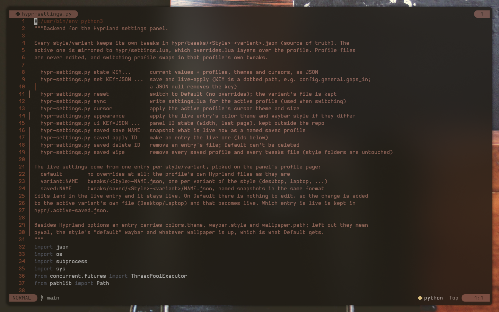
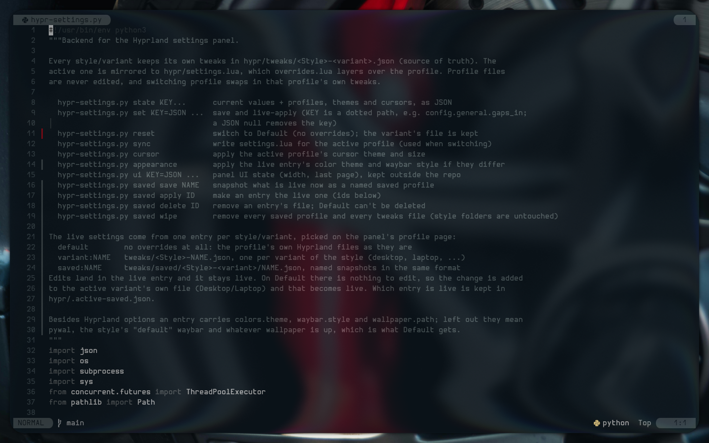
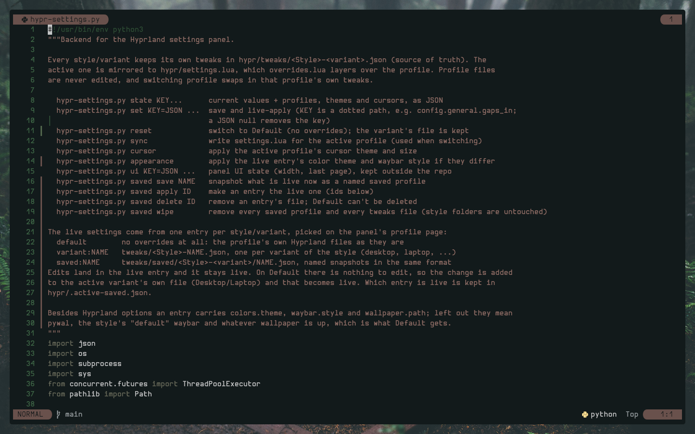
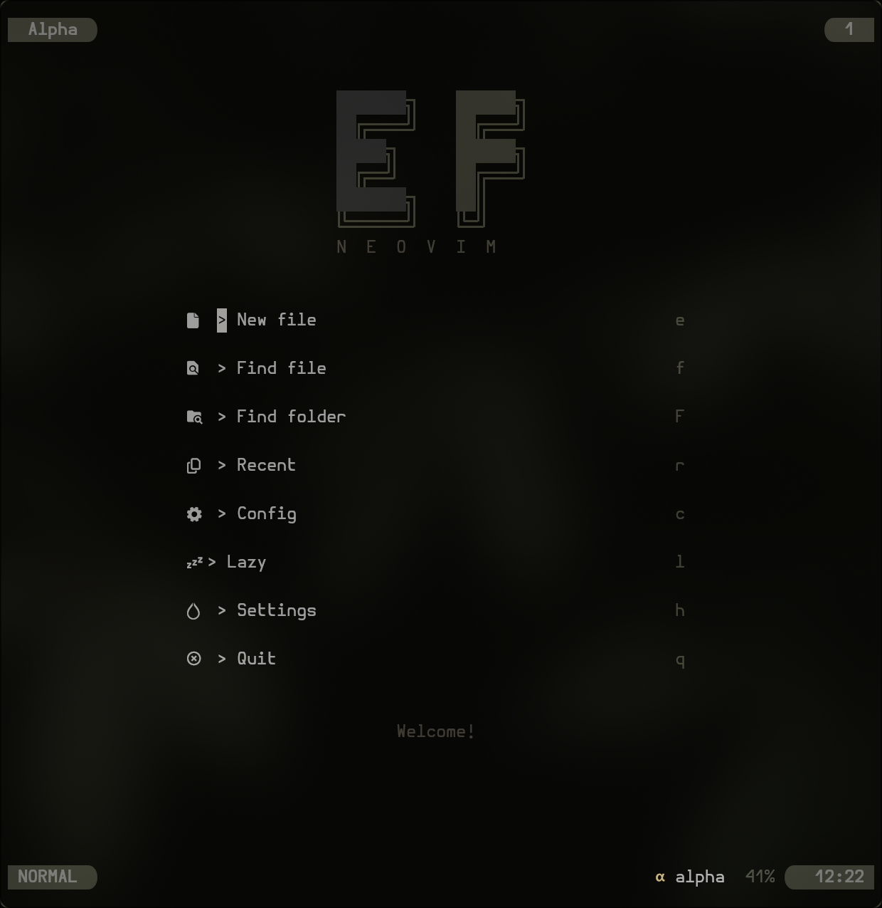
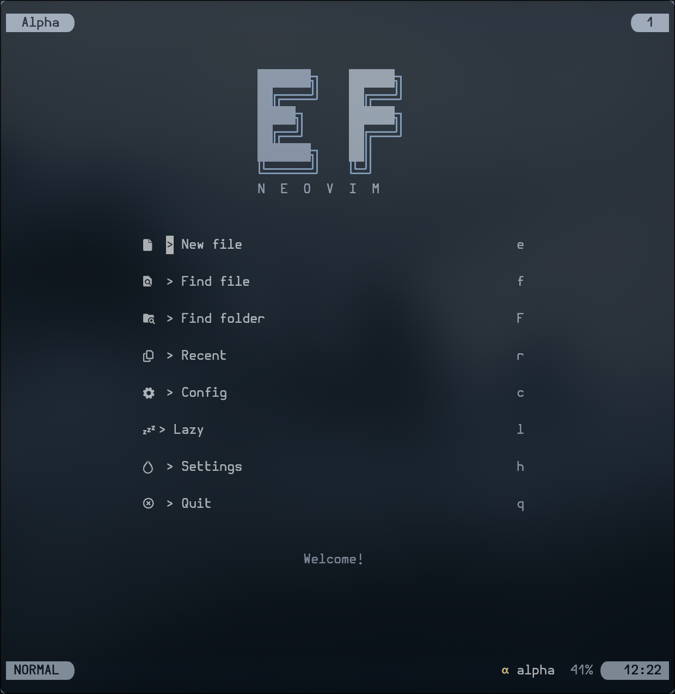
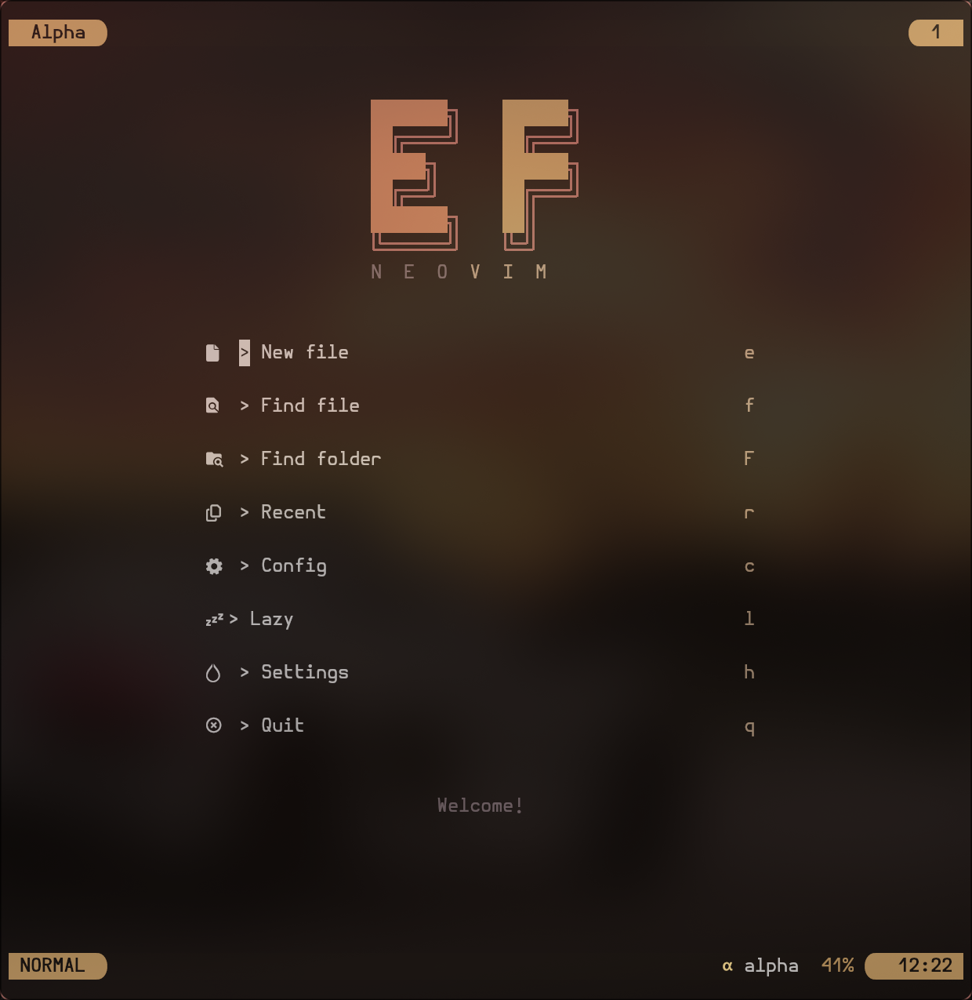

# MyNvim

 TOP nvim config. pywal, ready lsps.

<p align="center">
  
  
  
</p>
<p align="center">
  
  
  
</p>

## Install

```sh
git clone https://github.com/avkashik/MyNvim ~/.config/nvim
nvim
```

Plugins install themselves on first launch.

